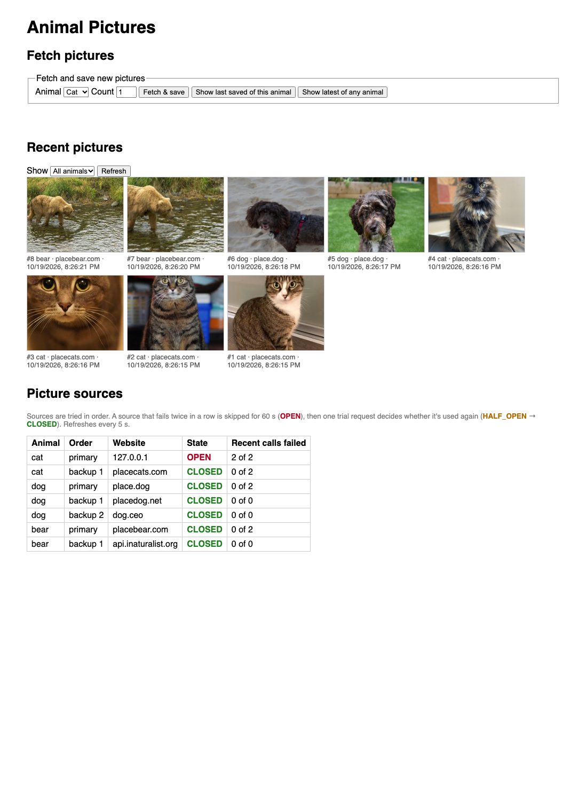

# Animal Picture App

A Spring Boot microservice that fetches random pictures of cats, dogs or bears from public picture APIs, stores them in an embedded **SQLite** database (image binary, timestamp, source website), and returns the latest stored picture. A simple web UI is served by the same app.

**Stack:** Java 21 · Spring Boot 4.1 · Maven (wrapper included) · SQLite (`sqlite-jdbc`) · Resilience4j · JUnit 5 / Mockito · Docker · GitHub Actions

## Running it

You can build and run it **from source** or **in Docker**. Each path works on its own.

### Option 1: From source (needs JDK 21)

```bash
./mvnw spring-boot:run          # macOS / Linux
mvnw.cmd spring-boot:run        # Windows
```

Or build the executable jar and run it:

```bash
./mvnw package
java -jar target/animal-picture-app-1.0.0.jar
```

- **No Maven install needed:** the wrapper downloads Maven.
- **No database setup needed:** the SQLite driver creates `./data/pictures.db` automatically on first start.
- **No application server needed:** the jar is a self-contained executable with an embedded web server (Tomcat inside the jar). You don't deploy it to a separate Tomcat or Apache server; `java -jar` is all it takes.

### Option 2: Docker (no Java needed)

```bash
docker compose up --build
```

The multi-stage `Dockerfile` builds from source inside the container (JDK stage, tests included) and runs the jar on a JRE-only image as a non-root user. The SQLite file is kept in the `picture-data` volume. `docker compose down -v` deletes it.

Then open **http://localhost:8080** for the UI.

### Tests

```bash
./mvnw test
```

47 tests:

- **Unit tests:** the picture client with a mocked HTTP server (image and JSON sources, fallback, URL rewriting, circuit breaker open / half-open / close), JSON Pointer lookup, and the service.
- **Config test:** checks that the shipped `application.yml` gives every animal a backup source.
- **Repository tests** against a real SQLite file built from `schema.sql`.
- **Integration tests:** the full app with a real SQLite file, with only the external APIs mocked.

They need no network access, so they run in CI.

## API

| Method | Path | Description |
|---|---|---|
| `POST` | `/api/pictures` | **a.** Fetches random pictures and stores them. Body: `{"animal": "cat\|dog\|bear", "count": 1-10}`. Returns `201` with metadata for each saved picture. |
| `GET` | `/api/pictures?animal=&limit=` | Recently stored pictures, newest first (metadata only). `animal` is optional; `limit` is 1–50, default 12 |
| `GET` | `/api/pictures/latest` | **b.** The **latest fetched picture** (any animal), as an image |
| `GET` | `/api/pictures/latest/metadata` | Its metadata as JSON |
| `GET` | `/api/pictures/{animal}/last` | Latest picture of one animal, as an image |
| `GET` | `/api/pictures/{animal}/last/metadata` | Its metadata as JSON |
| `GET` | `/api/pictures/{id}/image` | Any stored picture by id |
| `GET` | `/api/sources` | Every picture source and its circuit-breaker state (`CLOSED` = in use, `OPEN` = temporarily skipped, `HALF_OPEN` = next call is a trial) |

```bash
# a. Fetch and store 3 dog pictures
curl -X POST localhost:8080/api/pictures \
  -H 'Content-Type: application/json' \
  -d '{"animal": "dog", "count": 3}'

# b. Download the latest fetched picture
curl -o latest.jpg localhost:8080/api/pictures/latest
curl localhost:8080/api/pictures/latest/metadata
# {"id":6,"animalType":"DOG","contentType":"image/jpeg","sizeBytes":25134,
#  "sourceWebsite":"place.dog","sourceUrl":"https://place.dog/484/274",
#  "createdAt":"2026-10-19T07:17:19.572703Z","imageUrl":"/api/pictures/6/image"}
```

## Database schema

The schema is in [`src/main/resources/schema.sql`](src/main/resources/schema.sql) and runs at every startup. It's idempotent (`CREATE ... IF NOT EXISTS`):

```sql
CREATE TABLE IF NOT EXISTS picture (
    id             INTEGER PRIMARY KEY AUTOINCREMENT,
    animal_type    TEXT    NOT NULL CHECK (animal_type IN ('CAT', 'DOG', 'BEAR')),
    image          BLOB    NOT NULL,   -- the picture's binary data
    content_type   TEXT    NOT NULL,   -- e.g. image/jpeg
    source_website TEXT    NOT NULL,   -- e.g. placebear.com
    source_url     TEXT    NOT NULL,   -- full URL it was downloaded from
    created_at     TEXT    NOT NULL    -- fetch timestamp, ISO-8601 UTC
);
CREATE INDEX IF NOT EXISTS idx_picture_created_at ON picture (created_at);
CREATE INDEX IF NOT EXISTS idx_picture_animal_created_at ON picture (animal_type, created_at);
```

- **The SQLite file is created on the fly.** The `org.xerial:sqlite-jdbc` driver, added through Maven, bundles the native SQLite library and creates the `.db` file on first connection. The app creates the parent directory (`./data`) if it's missing.
- **Timestamp:** SQLite has no native timestamp type, so `created_at` is stored as **fixed-width** ISO-8601 UTC text (always 9 fractional digits, e.g. `2026-10-19T07:17:19.572703000Z`). That makes plain string ordering chronological, so "latest" is `ORDER BY created_at DESC, id DESC LIMIT 1`. The `id` breaks ties.
- **Inspecting the database:** `sqlite3 data/pictures.db "SELECT id, animal_type, source_website, created_at, length(image) FROM picture ORDER BY created_at DESC;"`

## Error handling

| Situation | Behaviour |
|---|---|
| A picture source is down, slow, returns something that isn't an image, or (for JSON sources) returns no image URL | Tries the **next source** for that animal (see below) |
| All sources for an animal fail | `502 Bad Gateway` with the reason; **nothing is saved** |
| Upstream too slow | 5 s connect / 10 s read timeout, then fall back or fail |
| A source keeps failing | **Circuit breaker:** after 2 failures in a row the source is skipped for 60 s, so requests go straight to the backup with no timeout wait (see below) |
| Partial failure in a batch (e.g. picture 3 of 5 fails) | All pictures are downloaded before anything is saved, and saving happens in one transaction, so there are no partial batches |
| Unknown animal, `count` outside 1–10, malformed JSON | `400 Bad Request` |
| No picture stored yet | `404 Not Found` |

Errors are returned in the standard problem JSON format (RFC 9457): `{"status": 502, "title": "Bad Gateway", "detail": "..."}`.

**Picture sources:** every animal has at least one backup. The sources are tried in order:

| Animal | Primary | Backups |
|---|---|---|
| Cat | [cataas.com](https://cataas.com) | [placecats.com](https://placecats.com) |
| Dog | [place.dog](https://place.dog) | [placedog.net](https://placedog.net), then [dog.ceo](https://dog.ceo/dog-api/) |
| Bear | [placebear.com](https://placebear.com) | [iNaturalist API](https://api.inaturalist.org/v1/docs/) (openly licensed research-grade bear photos) |

- **placekitten.com** (from the brief) is offline (HTTP 521), so cats come from cataas.com, which is on the public-apis list. cataas.com itself went down several times while I was testing (timeouts of 10–40 s), which is why every animal now has a backup.
- **Two kinds of source**, both configured in `application.yml` under `pictures.sources`:
  - **Image sources** return the picture directly, e.g. `https://placebear.com/{width}/{height}`. place.dog, placedog.net and placebear return the *same* picture for the same size, so each request uses a random width and height (200–600 px).
  - **JSON sources** return JSON containing the picture's URL, so the fetch has two steps. `image-url-path` is a JSON Pointer to that URL (e.g. `/message` for dog.ceo). For iNaturalist, a random results page (`{random}`, 1–7,000) gives a random bear. `image-url-find`/`image-url-replace` swap the 75 px thumbnail for the medium-size photo, and only CC0 / CC-BY / CC-BY-SA photos are requested.
- **`source_website`** is the host of the source that served the picture (e.g. `api.inaturalist.org`). **`source_url`** is the exact image URL that was downloaded.

### Circuit breaker

Each picture source has its own circuit breaker ([Resilience4j](https://resilience4j.readme.io/docs/circuitbreaker)):

- **CLOSED** (normal): the source is called as usual.
- **OPEN**: after **2 failures in a row**, the source is **skipped for 60 seconds**. Requests go straight to the next source instead of waiting out a timeout.
- **HALF_OPEN**: after the 60 s, the next request is a **trial call**. If it succeeds the circuit closes; if it fails it opens for another 60 s.
- **If every source for an animal is open**, the request fails immediately with `502` and doesn't wait.

Measured with a dead primary (connect timeout) and the real placecats.com as backup:

| Request | Time | |
|---|---|---|
| 1 | 6.4 s | primary times out → backup |
| 2 | 5.9 s | primary times out → backup, **circuit opens** |
| 3–6 | 0.25–0.47 s | primary skipped → backup immediately |

Check the live state with `GET /api/sources`. Tune it with `pictures.circuit-breaker.failure-threshold` and `open-duration` in `application.yml`.

## Web UI and CORS

- **UI:** the Spring Boot app also serves a small web UI (`src/main/resources/static/index.html`) at `/`. Plain HTML and JavaScript, no framework. It has three parts:
  - **Fetch pictures:** choose an animal and count, fetch and save, or show the latest picture.
  - **Recent pictures:** a gallery of the latest 24 pictures, filterable by animal, showing each one's source website and time. It refreshes after every fetch.
  - **Picture sources:** every source with its circuit-breaker state (`CLOSED` / `OPEN` / `HALF_OPEN`) and recent failures. It refreshes every 5 s.

  

  *Screenshot taken with the cat primary deliberately pointed at a dead address, to show an `OPEN` circuit; the cats came from the placecats.com backup.*

- **CORS isn't needed for this UI.** It's served from the same origin as the API.
- **CORS is configured for `/api/**`** so a UI hosted elsewhere (e.g. a React dev server) can call the API. Allowed origins come from `CORS_ALLOWED_ORIGINS`, default `http://localhost:3000,http://localhost:5173`. Requests from other origins are rejected with `403`.

## Configuration

| Variable | Default | Purpose |
|---|---|---|
| `PORT` | `8080` | HTTP port |
| `DB_URL` | `jdbc:sqlite:./data/pictures.db` | SQLite database location |
| `CORS_ALLOWED_ORIGINS` | `http://localhost:3000,http://localhost:5173` | Comma-separated origins allowed to call `/api/**` |

Circuit-breaker settings (`pictures.circuit-breaker.failure-threshold`, default 2; `open-duration`, default 60s) and the picture sources are in `application.yml`.

## CI/CD

[`.github/workflows/ci.yml`](.github/workflows/ci.yml) runs on every push and pull request:

1. **build-and-test:** `./mvnw -B verify` on JDK 21. It uploads the test reports and the executable jar as artifacts.
2. **docker-build:** builds the Docker image, which also runs the tests in the build stage.

## Project layout

```
src/main/java/com/example/animalpictures/
  api/        REST controllers (pictures, source status), request/response records, error handling, CORS config
  client/     HTTP client for the picture APIs (image + JSON sources, fallback, circuit breaker, timeouts)
  domain/     Picture record, JDBC repository, SQLite directory setup
  service/    Fetch-and-save logic (all-or-nothing batches)
src/main/resources/
  application.yml   configuration
  schema.sql        database schema
  static/index.html web UI
```

## Setting up in VS Code

See **[docs/VSCODE_SETUP.md](docs/VSCODE_SETUP.md)**. It covers the JDK, extensions, Maven integration, `pom.xml`, library downloads, and running, debugging and testing.

## What I'd add with more time

- **Parallel downloads** for larger `count` values (e.g. with virtual threads).
- **Schema migrations** (Flyway) once the schema starts to change.
- **Observability:** Spring Boot Actuator health/metrics and a Docker `HEALTHCHECK`.
- **OpenAPI docs** (springdoc) and a paginated `GET /api/pictures` listing.
- **A smaller image:** a jlink-trimmed JRE or a distroless base.
